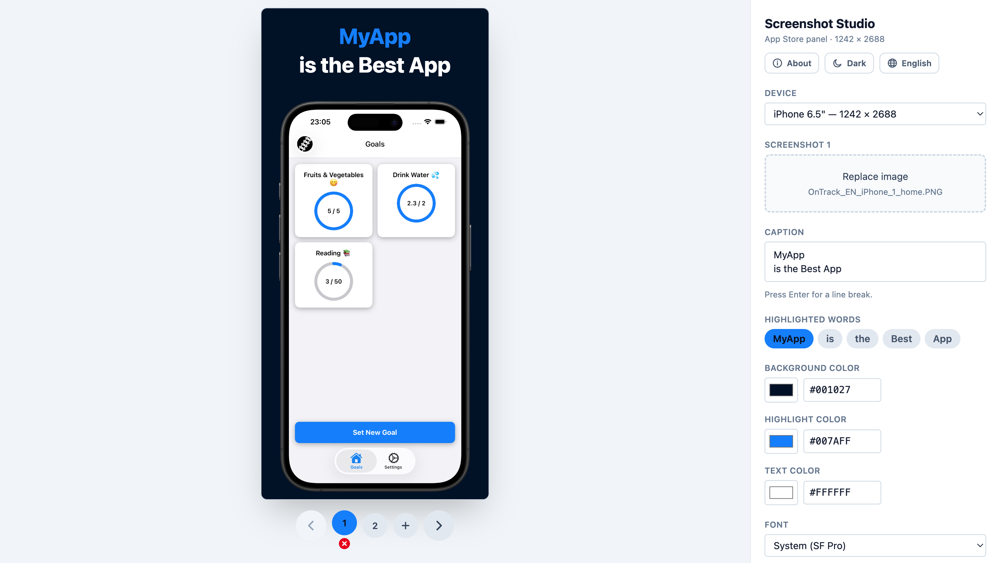
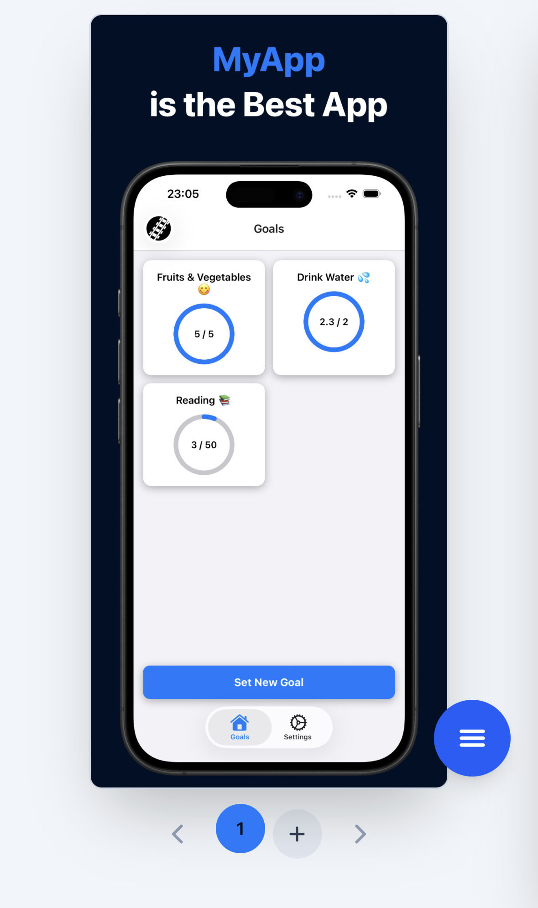

# Screenshot Studio

A fully client-side generator for marketing screenshots for the Apple App Store and the Google Play
Store. Drop a raw phone screenshot into a device frame, write a caption with one word picked out in
a highlight color, and export a ready-to-upload PNG. No backend, no account — nothing ever leaves
the browser.

Live at [screenshot-studio.aymeric.fyi](https://screenshot-studio.aymeric.fyi).



On a phone the controls collapse behind a floating button, leaving the preview and the strip the
full width:



## Devices

Four presets, one per listing size the two stores ask for:

| Device | Canvas | Store |
| --- | --- | --- |
| iPhone 6.5" (default) | 1242 × 2688 | App Store |
| iPad Pro 13" | 2064 × 2752 | App Store |
| Android phone | 1512 × 2688 | Play Store |
| Android tablet | 1548 × 2752 | Play Store |

Each device keeps its own deck of up to 10 screenshots — the store limit — and each screenshot
carries its own image, caption and colors, so restyling one leaves the rest alone. Switching device
swaps the whole deck: a phone capture center-cropped into a tablet's screen is not shippable.

## Saving your work

Everything you do is kept in your browser, images included, and comes back when you return. Nothing
is uploaded anywhere.

The **Export** menu offers three ways out:

- **Export this screenshot** — one PNG, at the exact size the store asks for.
- **Export all screenshots** — a single zip of every screenshot of every device, numbered in the
  order you see on the strip.
- **Save project (.zip)** — the whole project: a `project.json` describing every device, screenshot,
  caption and color, plus the original image files. **Load project** opens one back. It is an
  ordinary zip, so you can look inside it, keep it in a repo, or hand it to someone else.

## The template

A panel is a device-sized canvas with four layers, drawn bottom-up:

1. **Background** — a flat fill.
2. **Screenshot** — your uploaded image, aspect-filled and center-cropped into the device's screen
   rect, clipped to rounded corners.
3. **Device frame** — a transparent PNG whose bezel overlaps the screenshot.
4. **Caption** — a short sentence centered in the band between the top of the canvas and the top
   of the device, with any words you choose drawn in the highlight color.

All the geometry lives in `src/template.ts` (`DevicePreset`), and it is the only thing you need to
touch to add another device size. A preset's rects and its bundled frame asset were authored
against each other, so they only mean anything together.

## Architecture

The panel is drawn onto a real, full-size `<canvas>` by one pure function, `render()` in
`src/render.ts`. The preview you see is that same canvas scaled down with CSS, and export is
`canvas.toBlob()` — so **the preview is exactly what you export**, with no second rasterizer to
disagree with the DOM.

- `src/template.ts` — device geometry, fonts, and the `Design` model
- `src/render.ts` — the canvas renderer (caption layout, cover-fit, export)
- `src/text.ts` — caption tokenization (see below)
- `src/project.ts` — a project: live state in, stored record or `.zip` out, and back
- `src/db.ts` — IndexedDB, where your work is kept between visits
- `src/zip.ts` / `src/unzip.ts` — a zip writer and reader, so there is no dependency for either
- `src/i18n/` — UI translations (10 languages)
- `src/theme.ts` — light/dark, defaulting to the OS preference
- `src/components/ControlsPanel.tsx` — the editor UI

Stack: Vite, React 19, TypeScript, Tailwind v4.

### Captions in Japanese and Chinese

Splitting a caption on whitespace only works for languages that use it. Japanese and Chinese are
written without spaces, so a whitespace split would make the whole caption a single, unhighlightable
word. `src/text.ts` segments with `Intl.Segmenter` instead, and each token records whether real
whitespace preceded it — so the renderer wraps per word without inventing spaces the language
doesn't use.

## Fonts

The default is the **system** font (SF Pro Display on Apple platforms), which is what the source
template used. It renders differently off Apple platforms, so **Inter** is bundled with the app:
pick it when exports must be identical on any machine.

## Usage

```bash
npm install
npm run dev        # http://localhost:5173
npm run build      # static bundle in dist/ — deploy anywhere
```

`VITE_SITE_URL` in `.env` is the single source of truth for the deployed URL: it drives
`robots.txt`, `sitemap.xml`, `llms.txt` (all generated by `scripts/gen-seo.mjs`) and the
canonical/Open Graph tags in `index.html`. Change it there and nowhere else.

## Verification

There are no unit tests: everything is verified by driving the real app in headless Chrome, since
the whole product is a rendering pipeline plus a UI. Start `npm run dev`, then:

```bash
npm run verify                      # golden-image regression for the renderer
node scripts/verify-frames.mjs      # every device: canvas size, corner leaks, aperture bleed
node scripts/verify-ui.mjs          # every control, plus the export path
node scripts/verify-screenshots.mjs # the deck: chips, the 10 cap, per-slide isolation, export all
node scripts/verify-responsive.mjs  # desktop/mobile layout and the slide-over panel
node scripts/verify-theme.mjs       # light/dark, OS default, persistence
node scripts/verify-i18n.mjs        # all 10 locales, detection, persistence
node scripts/verify-cjk.mjs         # Japanese/Chinese/Korean caption segmentation
node scripts/verify-project.mjs     # work survives a reload; a project survives save/wipe/load
```

`npm run verify` renders a panel from `tests/fixtures/sample-screenshot.png` with a fixed design
and diffs it against `tests/fixtures/golden-panel.png`. Any change to the geometry, caption layout,
font metrics, corner masking or layer order shows up as a pixel difference. If a change was
intentional, re-record with `node scripts/verify-render.mjs --update` and review the diff.

The fixture is synthetic — `npm run fixture` redraws it from scratch (`scripts/gen-fixture.mjs`),
so the repo ships no third-party app screenshots.
